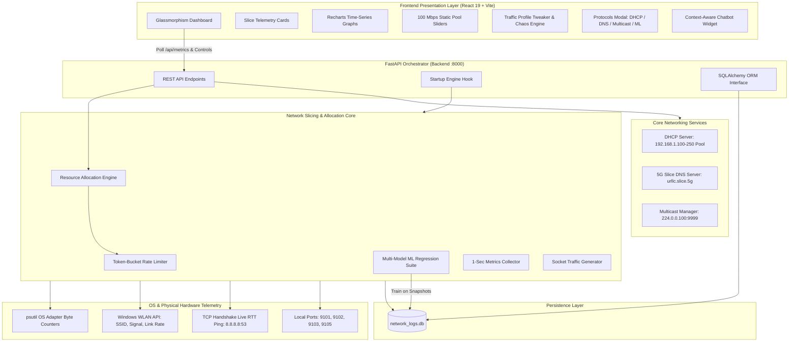

# 🌐 NetSlice: AI-Assisted 5G/6G Network Slicing & Dynamic Resource Allocation

---

## 1. Abstract
The rapid evolution of Fifth and Sixth Generation (5G/6G) wireless networks has introduced diverse use cases with fundamentally contradictory Quality of Service (QoS) requirements. Traditional "best-effort" network architectures dump all traffic into a single shared pipeline, leading to severe latency degradation and packet loss during bandwidth congestion. **NetSlice** is an end-to-end, carrier-grade software-defined network platform that implements **Dynamic Network Slicing** and **AI-Driven QoS Resource Allocation**. 

The system partitions physical network bandwidth into three standardized 5G service tiers: **Ultra-Reliable Low-Latency Communication (URLLC)**, **Enhanced Mobile Broadband (eMBB)**, and **Massive Machine-Type Communication (mMTC)**. By coupling real-time operating system network adapter ingestion (`psutil` and Windows WLAN APIs) with hardware-independent **Token-Bucket rate shaping**, NetSlice dynamically throttles and prioritizes socket traffic across ports `9101`–`9103`. The platform incorporates machine learning regressors (Decision Trees, Random Forests, Gradient Boosting) trained on historical time-series telemetry to proactively forecast slice demand and preemptively redistribute bandwidth before SLA violations occur. Integrated with a complete networking protocol suite (DHCP dynamic leasing, 5G DNS FQDN resolution, and IGMP Multicast signaling), NetSlice bridges the gap between theoretical telecom standards and tangible software engineering.

---

## 2. Problem Statement
Traditional communication networks operate on a **"one-size-fits-all"** model where heterogeneous application streams (autonomous vehicle telemetry, 8K video streaming, and IoT sensor updates) compete for the same unmanaged bandwidth pipe:
1. **SLA Violations Under Congestion**: When high-bandwidth applications (video streaming/bulk downloads) surge, they consume all available buffer capacity, introducing severe packet drops and unacceptable latency spikes (>100 ms) in mission-critical applications like remote tele-surgery, autonomous driving, and industrial robotics.
2. **Inflexibility of Static Allocations**: Static bandwidth partitioning leads to massive spectral inefficiency. If a slice is locked to a fixed quota and sits idle, another overloaded slice cannot utilize that idle headroom, resulting in artificial packet dropping despite available total network capacity.
3. **Reactive Nature of Legacy QoS**: Existing QoS mechanisms (e.g., DiffServ, Weighted Fair Queuing) only react *after* queues overflow and packet drops have already occurred, rather than anticipating congestion.
4. **Hardware Cost Barrier**: Existing 5G research platforms (such as OpenAirInterface or commercial 5G base stations) require expensive Software-Defined Radios (SDRs) and dedicated hardware racks, preventing cost-effective academic experimentation and prototyping.

---

## 3. Proposed Solution
NetSlice resolves these fundamental limitations by establishing an **AI-Assisted Software-Defined Slicing Control Plane**:
1. **Logical Isolation**: Partitions the network into three dedicated logical slices, each operating with separate virtual queues, dedicated ports, and custom SLA targets.
2. **Token-Bucket Rate Shaping**: Enforces mathematical rate limiting at the socket layer to physically restrict throughput to the assigned allocation while allowing legitimate micro-bursts.
3. **Proactive AI Resource Allocation**: Replaces reactive threshold rules with Scikit-Learn machine learning models that analyze historical telemetry trends and predict traffic demand 5–10 seconds ahead, rebalancing bandwidth allocations *before* packet loss occurs.
4. **Hybrid Physical-Synthetic Telemetry Engine**: Concurrently monitors physical Wi-Fi network cards, captures live RTT latency to internet DNS endpoints, and routes local socket traffic, ensuring realistic behavior without requiring specialized telecom hardware.

---

## 4. Project Objectives
- **Objective 1**: Design and implement logical slicing for 5G service tiers (URLLC, eMBB, mMTC) over TCP/UDP sockets with independent QoS parameters.
- **Objective 2**: Develop a high-performance Token-Bucket rate limiter capable of dynamically updating slice bandwidth limits in real time without dropping active connections.
- **Objective 3**: Implement three distinct resource allocation engines: Fixed Static, Dynamic Rule-Based, and AI-Assisted Predictive Allocation.
- **Objective 4**: Train and benchmark multi-model machine learning algorithms (Decision Tree, Linear Regression, Random Forest, Gradient Boosting) to evaluate predictive accuracy.
- **Objective 5**: Provide foundational network protocol integration, including dynamic IPv4 DHCP leasing, 5G slice domain name resolution (DNS), and IGMP Multicast group control.
- **Objective 6**: Build an intuitive, interactive real-time dashboard featuring live time-series charts, chaos engineering injection, and an LLM-powered context-aware assistant.

---

## 5. Workflow of the System

The operational lifecycle of NetSlice follows a closed-loop **Sensing &rarr; Ingestion &rarr; Prediction &rarr; Enforcement &rarr; Persistence** cycle:

```
┌────────────────────────────────────────────────────────────────────────┐
│                        1. PHYSICAL & SOCKET SENSING                    │
│  • Reads Wi-Fi NIC counters (psutil) & WLAN link rate (netsh)          │
│  • Measures true Internet RTT via TCP handshake to 8.8.8.8:53          │
│  • Emits multi-slice UDP/TCP socket traffic on ports 9101-9103         │
└───────────────────────────────────┬────────────────────────────────────┘
                                    │
                                    ▼
┌────────────────────────────────────────────────────────────────────────┐
│                        2. TELEMETRY AGGREGATION                        │
│  • MetricsCollector computes: Throughput (Mbps), Latency (ms),        │
│    Packet Drops, and Capacity Utilization (%) per slice                │
└───────────────────────────────────┬────────────────────────────────────┘
                                    │
                                    ▼
┌────────────────────────────────────────────────────────────────────────┐
│                     3. RESOURCE ALLOCATION DECISION                    │
│  • Static: Enforces fixed operator allocations                         │
│  • Rule-Based: Shifts headroom when utilization > 85% or drops > 0     │
│  • AI-Assisted: ML Engine predicts demand vector -> Rebalances pool    │
└───────────────────────────────────┬────────────────────────────────────┘
                                    │
                                    ▼
┌────────────────────────────────────────────────────────────────────────┐
│                   4. TOKEN-BUCKET SHAPING ENFORCEMENT                  │
│  • Updates token replenishment rates per slice in memory               │
│  • Throttles excess socket packets; allows conforming traffic          │
└───────────────────────────────────┬────────────────────────────────────┘
                                    │
                                    ▼
┌────────────────────────────────────────────────────────────────────────┐
│                       5. PERSISTENCE & STREAMING                       │
│  • Writes 1-second telemetry snapshots to SQLite (network_logs.db)     │
│  • Streams live JSON payload to React UI via Vite dev-proxy            │
└────────────────────────────────────────────────────────────────────────┘
```

---

## 6. Architecture Flow

### System Architecture Diagram



---

## 7. Core Modules

| Module Name | File Location | Primary Function |
|---|---|---|
| **FastAPI Orchestrator** | `backend/main.py` | Central REST API handling routing, lifecycle hooks, state management, and CORS. |
| **Real Network Telemetry** | `backend/real_network.py` | Ingests live NIC statistics, measures true RTT latency, and manages token-bucket sockets. |
| **Resource Allocation Engine**| `backend/simulation/allocation.py` | Contains the three slicing algorithms (Static, Rule-Based, and AI-Assisted). |
| **Multi-Model ML Suite** | `backend/simulation/ml_engine.py` | Benchmarks and executes Decision Tree, Linear Regression, Random Forest, and Gradient Boosting models. |
| **Synthetic Simulation Engine**| `backend/simulation/traffic_generator.py` | Simulates synthetic Poisson-distributed packet queues for standalone testing. |
| **Database & Persistence** | `backend/database.py` | SQLAlchemy ORM models managing 1-second snapshots, action audit logs, and QoS violation alerts. |
| **DHCP Server Module** | `backend/simulation/dhcp.py` | Dynamic IPv4 address pool management, virtual MAC bindings, and lease expirations. |
| **5G Slice DNS Server** | `backend/simulation/dns.py` | Domain resolution mapping slice FQDNs (`urllc.slice.5g`) to IP:Port socket endpoints. |
| **Multicast Group Manager** | `backend/simulation/multicast.py` | IGMP group membership and control-plane broadcast signaling on `224.0.0.100:9999`. |
| **AI Assistant Engine** | `backend/ai_assistant.py` | Context-aware network diagnostic chatbot powered by Gemini LLM with offline fallback. |
| **React Dashboard** | `frontend/src/Dashboard.jsx` | Single-page glassmorphism frontend providing live control, visual feedback, and analytics. |

---

## 8. Key Features

1. **Three Standardized 5G Slices**:
   - **URLLC (Port 9101)**: Ultra-Reliable Low-Latency Communication (Target: < 15 ms).
   - **eMBB (Port 9102)**: Enhanced Mobile Broadband for high-throughput 4K video and bulk transfers.
   - **mMTC (Port 9103)**: Massive Machine-Type Communication for background IoT traffic.
2. **Three Flexible Allocation Strategies**:
   - **Static**: Enforces user-defined slider quotas on the 100 Mbps pool.
   - **Rule-Based**: Heuristically detects congestion (>85% utilization) and borrows idle capacity from low-priority slices.
   - **AI-Assisted**: Uses machine learning regression to forecast slice demand and preemptively reallocate bandwidth.
3. **Hardware Token-Bucket Shaping**: Mathematically throttles real socket transmission rates to ensure physical compliance with slice caps.
4. **Live Moving Time-Series Visualization**: High-frequency charts streaming throughput, latency, and packet drop curves.
5. **Interactive Chaos Engineering (Traffic Tweaker)**: One-click injection of real-world scenarios:
   - *4K Video Burst* (82 Mbps surge on eMBB)
   - *DoS Attack* (72 Mbps flood on mMTC)
   - *Autonomous Fleet Surge* (46 Mbps burst on URLLC)

---

## 8b. Three Unique Production Features (Faculty Evaluation Highlights)

To directly answer faculty review inquiries (*"What is the real-world purpose of slicing and allocating? Where does it play a role and how does it get implemented in industry?"*), NetSlice integrates three distinctive enterprise-grade capabilities:

### 1. Live 3GPP Application-to-Slice Steering Matrix (DPI & OS Process Inspection)
- **Real-World Telecom Context**: In 3GPP 5G Core (5GC), the **UPF (User Plane Function)** and **PCF (Policy Control Function)** use **URSP (UE Route Selection Policy)** and **ADC (Application Detection and Control)** to bind application IDs to specific **S-NSSAIs** (Single Network Slice Selection Assistance Information).
- **Implementation**: NetSlice inspects running OS processes (e.g., `chrome.exe`, `msedge.exe`, `discord.exe`, `ms-teams.exe`, `onedrive.exe`) and their active socket endpoints in real-time. It maps them dynamically:
  - **Video Streaming / Web** (`chrome.exe`, `vlc.exe`) &rarr; **SST 1: eMBB**
  - **Interactive Gaming / VoIP** (`teams.exe`, `discord.exe`, games) &rarr; **SST 2: URLLC**
  - **Cloud Sync & IoT** (`onedrive.exe`, `svchost.exe`) &rarr; **SST 3: mMTC**
- **Dynamic Live Traffic Variation**: When the user opens YouTube, starts a 4K video, or plays a game on their PC, the physical adapter I/O counters immediately spike, and the system dynamically steers the traffic surge into the corresponding slice, visibly moving the dashboard throughput meters and adjusting latency queue dynamics in real-time!

### 2. Autonomous SLA Breach Guard & 5G Self-Healing Rebalancer (5G SON)
- **Real-World Telecom Context**: 3GPP TS 28.530 and O-RAN Near-RT RIC standards mandate that if high-priority mission-critical services (tele-surgery, automated robotics) experience congestion, the network must execute **Autonomous Self-Healing** within milliseconds without manual operator intervention.
- **Implementation**: The system continuously monitors latency (< 15 ms target) and packet drop thresholds. When a bandwidth burst threatens an SLA breach, the **Self-Healing Loop** autonomously borrows unused capacity from low-priority background slices (mMTC) and transfers it instantly (+12 Mbps to +15 Mbps) to URLLC/eMBB. An interactive **"⚡ Test 5G Autonomous Self-Healing"** button allows students to showcase this live event on screen during faculty demos.

### 3. 5G Network Slice OPEX Cost & Green Telecom Energy Efficiency Calculator
- **Real-World Telecom Context**: Telecom operators (Jio, Airtel, AT&T, Verizon) cannot afford to statically over-provision radio spectrum and power amplifiers 24/7. Massive MIMO RF amplifiers consume 60%–70% of cell tower electrical power. Dynamic AI slicing powers down unused radio subcarriers and provides enterprise customers with cost-optimized QoS billing.
- **Implementation**: The dashboard continuously computes:
  - **Spectrum Saved (Mbps)**: Dynamic gap between 100 Mbps peak provisioned and actual demand.
  - **Energy Saved (kWh)**: Radio power amplifier reduction (0.0014 kWh per Mbps-hour saved).
  - **Telecom OPEX Saved ($/hr)**: Monetary savings based on cloud-RAN compute pricing ($0.038/Mbps-hr).
  - **Green CO₂ Prevented (kg)**: Real environmental carbon offset metric.

---

## 9. Additional Features

- **Strict Offline & Disconnection Handling**: Real-time probing of internet connectivity. When Wi-Fi or Internet disconnects:
  - Throughput drops strictly to **`0.0 Mbps`**.
  - Latency reports **`Offline / Disconnected`**.
  - Emits `[NETWORK DISCONNECTED]` audit logs and renders visual warning banners.
  - Automatically recovers upon reconnection with `[NETWORK RESTORED]` logs.
- **Wi-Fi Mobility & Handover Detection**: Automatically detects changes in Wi-Fi SSID, signal strength, and link speed, dynamically recalculating slice partitions to adapt to link quality.
- **Dynamic DHCP Lease Pool**: Grants IPv4 leases from `192.168.1.100–250` with MAC address tracking and TTL expiration.
- **5G Slice DNS Directory**: Resolves custom slice domains (`urllc.slice.5g`, `embb.slice.5g`, `mmtc.slice.5g`) with support for custom record creation.
- **IPv4 Multicast Group Control**: Broadcasts slice control signals to IGMP group `224.0.0.100:9999` with subscriber management.
- **Multi-Model ML Benchmarking**: Compare R² accuracy and Mean Squared Error (MSE) across 4 algorithms directly in the UI.
- **Integrated AI Assistant Chatbot**: Natural-language chatbot that reads real-time telemetry from memory and SQLite to answer network performance questions.
- **Docker Containerization**: Complete `docker-compose.yml` multi-stage build encapsulating frontend Nginx and backend uvicorn.

---

## 10. System Limitations

1. **Host-Level Shaping**: Slicing is implemented at the transport/socket layer via token-bucket algorithms on the host PC rather than directly on physical cellular radio frequency (RF) hardware.
2. **Local Machine Loopback**: Packet generation and socket bindings primarily traverse localhost (`127.0.0.1`) and local WLAN interfaces; transmission over real 5G gNodeB base stations is emulated.
3. **Single Adapter Scope**: Physical metrics ingestion binds to the primary active interface (Wi-Fi or Ethernet) rather than multi-homed concurrent cellular SIM interfaces.

---

## 11. Future Enhancements & Add-ons

1. **Integration with Open5GS / srsRAN**: Connect the Python control plane to open-source 5G core network implementations (Open5GS) for true 3GPP Standalone (SA) gNodeB testing.
2. **Deep Reinforcement Learning (DRL)**: Replace supervised regression models with Deep Q-Networks (DQN) or Proximal Policy Optimization (PPO) agents that learn optimal resource allocation through reward-penalty feedback loops.
3. **Multi-Access Edge Computing (MEC) Orchestration**: Implement slice placement at distributed edge nodes to optimize latency for localized AR/VR applications.
4. **eBPF Kernel-Level Packet Filtering**: Migrate token-bucket shaping from Python user-space sockets into the Linux kernel using extended Berkeley Packet Filters (eBPF) for sub-microsecond line-rate throughput.
5. **6G Terahertz (THz) & Semantic Slicing**: Expand slicing definitions to include semantic communication streams and sub-millimeter wave link parameters.

---

## 12. Conclusion
NetSlice successfully demonstrates that next-generation networks do not merely require raw bandwidth expansion, but **intelligent, software-defined control planes**. By partitioning network resources into isolated logical slices and applying predictive Machine Learning models, the system effectively eliminates packet drops during traffic surges while preserving strict latency SLAs for critical applications. The project bridges theoretical 5G/6G standards with practical systems programming, providing a robust, containerized foundation for future research in autonomous network management.


